[GoAkt actor model](https://docs.goakt.dev/actor/actor-model)

## Actor communication

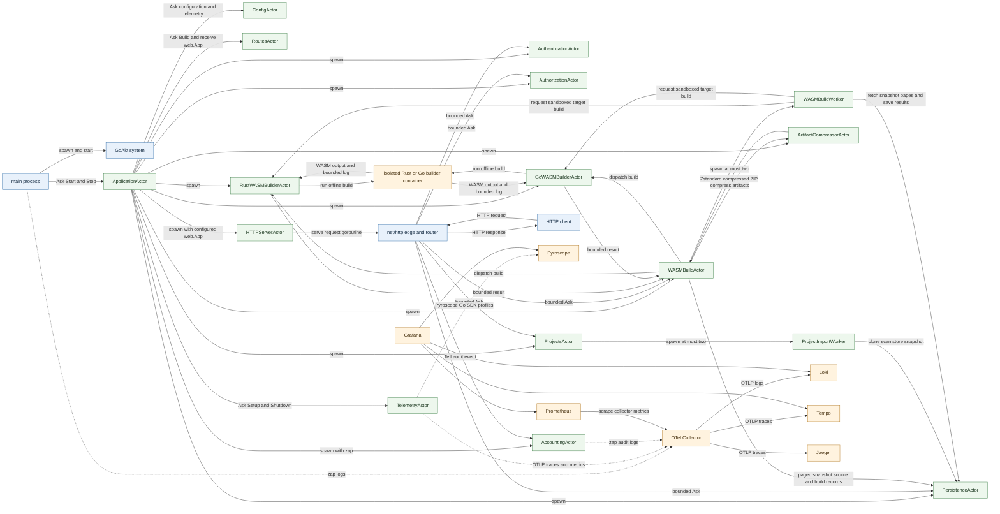

HTTP route handlers run on net/http request goroutines. They make bounded GoAkt requests to service actors; route handlers, rather than actor receive turns, coordinate multi-actor request flows. SQLite is owned by PersistenceActor; import and build work runs in bounded worker actors. OAuth tokens are encrypted before storage. The `web.App` is built once by RoutesActor and treated as read-only while the HTTP server serves it. Authorization uses the embedded default-deny OPA policy, and persistence queries scope project, import, snapshot, and artifact access to the authenticated owner.

## HTTP authentication flow

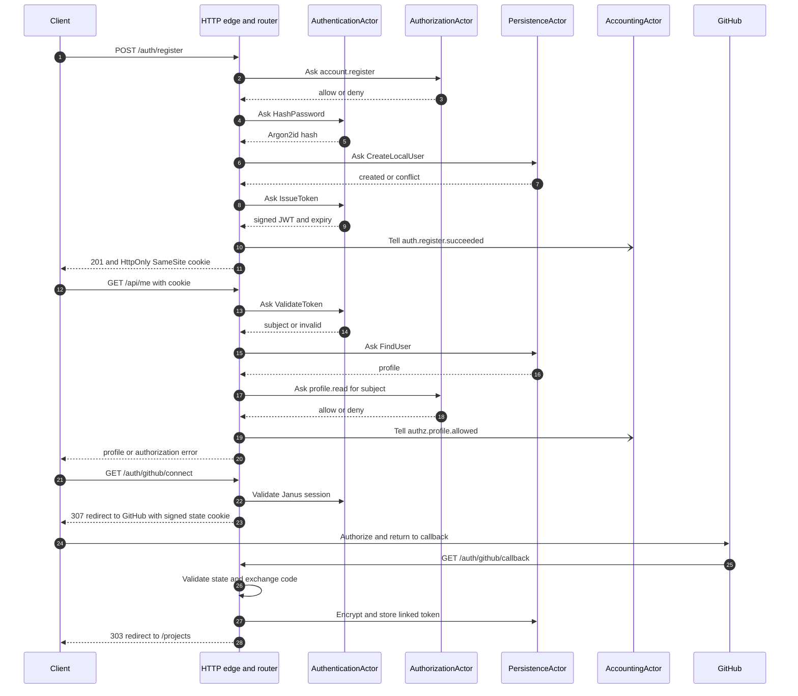

## HTTP API behavior

The HTTP edge accepts the routes below. Unless a route is described as a redirect, HTML page, empty response, or file download, successful responses use JSON. JSON request bodies are capped at 1 MiB by the HTTP server. Handlers that decode JSON reject unknown fields and extra JSON values. JSON errors use `{"error":"..."}` with `Content-Type: application/json`. Send `Content-Type: application/json` for JSON request bodies.

| Method and path | Request | Success | Other responses |
| --- | --- | --- | --- |
| `GET /healthz` | None | `200` `{"status":"ok"}` | — |
| `POST /auth/register` | `{"email":"person@example.com","password":"at-least-12-bytes"}` | `201` with `{"id":"<user-id>","email":"person@example.com"}` and a session cookie | `400` invalid JSON/email/password; `403` registration denied by policy; `409` account already exists; `500` internal failure |
| `POST /auth/login` | Same credential fields | `200` with `{"id":"<user-id>","email":"person@example.com"}` and a session cookie | `400` invalid input; `401` invalid email/password; `403` login denied by policy; `500` internal failure |
| `POST /auth/logout` | None; cookie is optional | `303` redirect to `/` and an expired session cookie | — |
| `GET /api/me` | `janus_session` cookie | `200` with `{"id":"<user-id>","email":"person@example.com","display_name":"..."}` | `401` missing/invalid/expired session or deleted account; `403` profile read denied; `500` internal failure |
| `GET /auth/google` | None | When enabled, `307` redirect to Google's authorization page and temporary OAuth state cookie | `503` Google sign-in is not configured; `403` denied by policy; `502` provider flow could not be started; `500` internal failure |
| `GET /auth/google/callback` | OAuth callback query and temporary OAuth state cookie | `307` redirect to `/`, with the session cookie set | `503` not configured; `403` denied by policy; `401` provider authentication failed; `500` internal failure |
| `GET /auth/github` | None | When enabled, `307` to GitHub for login | `503` not configured; `403` denied by policy |
| `GET /auth/github/callback` | GitHub callback query and signed OAuth state cookie | Login: `303` to `/projects` and session cookie; account email conflict: `303` to `/?github=account_exists`; provider cancellation: `303` to `/?github=cancelled`; connect: `303` to `/projects?github=connected` | `400` invalid state/incomplete response; `401` invalid session during connect; `403` repository access not granted; `409` GitHub identity already linked; `502` provider token/profile failure |
| `GET /auth/github/connect` | Authenticated session | When enabled, `307` to GitHub requesting repository access | `401` missing/invalid session; `403` denied by policy; `503` not configured |
| `POST /auth/github/disconnect` | Authenticated session | `303` redirect to `/projects`; removes linked token | `401` missing/invalid session; `403` denied by policy; `500` internal failure |
| `GET /projects` | Authenticated session | `200` HTML list of the owner's projects | `303` to `/` if unauthenticated; `500` internal failure |
| `GET /projects/new`, `GET /projects/import`, `GET /projects/{id}` | Authenticated session | `200` HTML project pages; import page requires GitHub linked | `303` to `/` if unauthenticated; `404` unknown project; `503` GitHub import not configured |
| `POST /projects` | Form fields `name`, `description` | `303` to the created project page | `400` invalid form/data; `303` to `/` if unauthenticated; `403` denied by policy |
| `GET /api/projects` | Authenticated session | `200` array of the owner's projects | `401` missing/invalid session; `500` internal failure |
| `POST /api/projects` | `{"name":"Demo","description":"Example"}` | `201` created project object | `400` invalid JSON/name/description; `401` missing/invalid session; `403` denied by policy; `409` create conflict |
| `GET /api/projects/{id}` | Authenticated session | `200` owner-scoped project object | `401` missing/invalid session; `404` not found or not owned |
| `PUT /api/projects/{id}` | `{"name":"Demo","description":"Updated"}` | `200` updated project object | `400` invalid data; `401` missing/invalid session; `404` not found or not owned |
| `DELETE /api/projects/{id}` | Authenticated session | `204` empty response | `401` missing/invalid session; `404` not found or not owned; `409` import is in progress |
| `GET /api/github/repos` | Authenticated session with GitHub connected | `200` repository list | `401` missing/invalid session; `502` GitHub API failure |
| `GET /api/github/branches?repository=owner/repo` | Authenticated session with GitHub connected | `200` branch list | `401` missing/invalid session; `502` GitHub API failure |
| `GET /api/github/commits?repository=owner/repo&branch=main` | Authenticated session with GitHub connected | `200` commit list | `401` missing/invalid session; `502` GitHub API failure |
| `POST /api/projects/{id}/imports` | `{"repository":"owner/repo","branch":"main","commit":"<sha>"}` | `202` `{"job_id":"...","status":"queued"}` | `400` invalid/rejected request; `401` missing/invalid session; `404` project missing; `409` conflict; `503` unavailable |
| `GET /api/imports/{id}` | Authenticated session | `200` owner-scoped import job with state/progress/error | `401` missing/invalid session; `404` not found or not owned |
| `GET /api/projects/{id}/snapshots` | Authenticated session | `200` list of up to five successful snapshots, including active marker | `401` missing/invalid session; `404` project not found |
| `POST /api/projects/{id}/snapshots/{snapshot}/activate` | Authenticated session | `200` `{"active":true}` | `401` missing/invalid session; `404` snapshot not found |
| `POST /api/projects/{id}/entrypoint` | `{"snapshot_id":"...","entry_point":"src/main.rs"}`; empty entry point clears selection | `200` `{"entry_point":"..."}` | `400` invalid selection; `401` missing/invalid session |
| `POST /api/projects/{id}/wasm-builds` | `{"target":"wasm32-unknown-unknown"}` / `{"target":"wasm32-wasip1"}` for Rust; `{"target":"wasip1-wasm"}` for Go | `202` `{"job_id":"...","status":"queued"}` | `400` unsupported target/no buildable snapshot; `401` missing/invalid session; `404` project/snapshot missing; `409` build already running; `503` builder unavailable |
| `GET /api/wasm-builds/{id}` | Authenticated session | `200` owner-scoped status, progress, bounded compiler log and artifact name | `401` missing/invalid session; `404` not found or not owned; `503` builder unavailable |
| `GET /api/wasm-builds/{id}/artifact` | Authenticated session and completed build ID | `200` downloadable `.zip.zst` (Zstandard-compressed ZIP of generated `.wasm` files) | `401` missing/invalid session; `404` artifact not found or not owned |
| `POST /api/wasm-builds/{id}/runs` | `{"args":["optional","arguments"]}`; args may be omitted | `202` `{"run_id":"...","status":"running"}` | `400` invalid request; `401` missing/invalid session; `404` build/snapshot missing; `409` runtime limit/conflict; `503` runtime unavailable |
| `GET /api/wasm-runs/{id}` | Authenticated session | `200` owner-scoped run status, captured output, and `usage` (`fuel`, `peak_memory_bytes`, `duration_ms`) | `401` missing/invalid session; `404` run not found or not owned; `503` runtime unavailable |
| `GET /` | Optional session cookie | `200` HTML homepage, signed-in identity shown when valid; missing/invalid session shows the public homepage | `500` internal failure when profile lookup fails for a valid session |

Example local registration:

```sh
curl -i http://localhost:9090/auth/register \
  -H 'Content-Type: application/json' \
  --data '{"email":"person@example.com","password":"a-long-example-password"}'
```

Save the returned `janus_session` cookie and send it on authenticated requests. The cookie is `HttpOnly`, `SameSite=Lax`, scoped to `/`, and uses `Secure` when `JANUS_COOKIE_SECURE=true`. Its lifetime matches the configured JWT expiry. Login and registration return the cookie in `Set-Cookie`; clients should not copy the token into JavaScript-accessible storage. Logout expires the browser cookie but does not revoke a copied JWT, which remains usable until it expires.

Credential validation trims surrounding whitespace from the email for registration and accepts email addresses up to 254 bytes. Passwords are measured in bytes: registration requires 12–1024 bytes, while login accepts 1–1024 bytes. Malformed JSON, unknown fields, multiple JSON values, and JSON whose initial value cannot be decoded within the 1 MiB read limit are reported as `400` by the credential routes.

Project APIs use the `janus_session` cookie and only expose records belonging to its subject. A successful import activates its snapshot; the five newest successful snapshots are retained, and users can activate a retained revision. GitHub login requests `read:user` and `user:email`; connecting an account for imports additionally requests `repo`. The OAuth state cookie expires after ten minutes. A GitHub email already used by a Janus account is not automatically linked: sign in to that Janus account and connect GitHub from `/projects`.

Unknown paths return `404` with the plain-text body `NOT_FOUND`. A path registered for another HTTP method also returns `404`; the router does not currently generate `405 Method Not Allowed` or an `Allow` header. The HTTP server also provides Go `net/http` protocol handling; API behavior here describes application responses after routing.

## Startup and shutdown sequence

```mermaid
sequenceDiagram
    autonumber
    participant Main
    participant App as ApplicationActor
    participant Config as ConfigActor
    participant Telemetry as TelemetryActor
    participant Persistence as PersistenceActor
    participant Auth as AuthenticationActor
    participant Authz as AuthorizationActor
    participant Accounting as AccountingActor
    participant Projects as ProjectsActor
    participant Builders as Rust and Go builders
    participant WASM as WASMBuildActor
    participant Routes as RoutesActor
    participant HTTP as HTTPServerActor

    Main->>App: Ask Start
    App->>Config: Load .env and validated settings
    App->>Telemetry: Setup OTLP providers
    App->>Accounting: Spawn with zap logger
    App->>Persistence: Spawn with SQLite path
    App->>Auth: Spawn with JWT settings
    App->>Authz: Spawn with embedded policy
    App->>Projects: Spawn project/import coordinator
    App->>Builders: Spawn Rust and Go builders
    App->>Docker: Ask EnsureRunning; start Docker Desktop if needed and verify engine
    App->>WASM: Spawn build coordinator and compressor
    App->>Routes: Ask Build
    Routes-->>App: Built web.App
    App->>HTTP: Spawn listener with web.App
    HTTP-->>App: PreStart complete
    App-->>Main: Started

    Main->>App: Ask Stop
    App->>HTTP: Ask Stop
    HTTP->>HTTP: Shutdown net/http
    App->>Projects: Drain repository import workers
    App->>WASM: Drain WASM build workers
    App->>Persistence: Ask CloseDatabase
    App->>Accounting: Ask Flush
    App->>Telemetry: Ask Shutdown
    Telemetry->>Telemetry: Flush traces metrics and logs
    App-->>Main: Stopped
```

## Actor responsibilities

### ApplicationActor

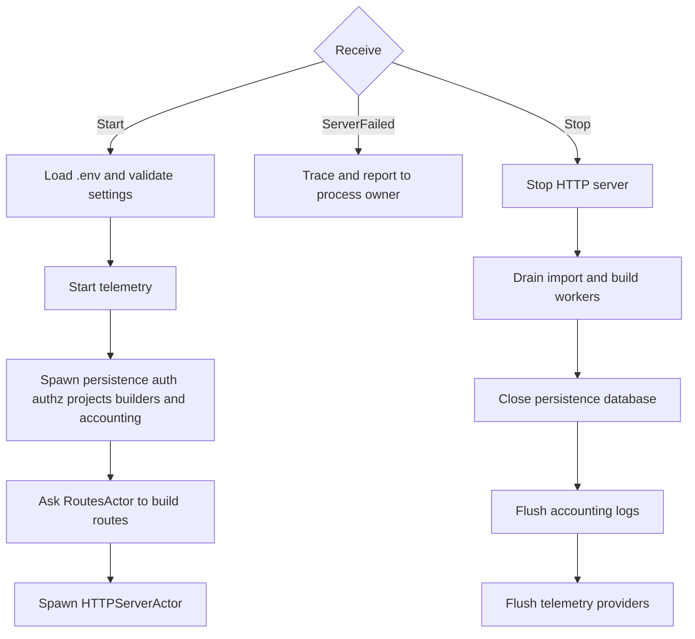

Application startup asks DockerControllerActor to ensure the Docker Engine is reachable. If `docker info` fails, the controller runs `docker desktop start --timeout 60s` and checks the engine again. Startup fails with the Docker command's error if the engine cannot be brought up. This recovery path requires the Docker Desktop CLI plugin.

### ConfigActor

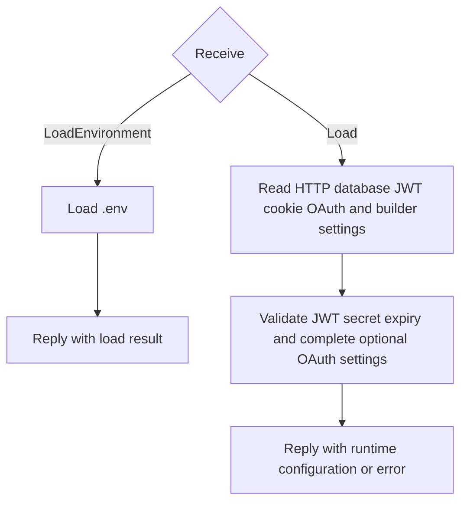

### RoutesActor

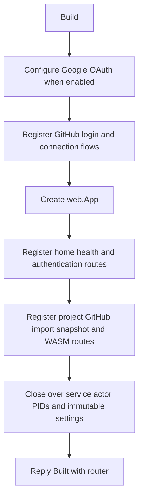

### HTTPServerActor

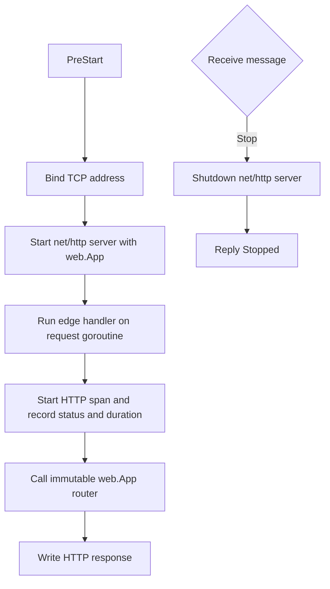

### Import and WASM build pipeline

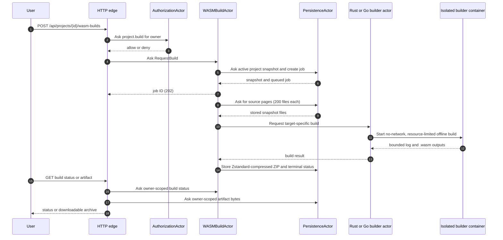

The project actor imports GitHub repositories using an owner-linked token. At most two import jobs run concurrently. A source snapshot is limited to 50,000 files, 16 MiB per file, 256 MiB total, and clone depth 50. The scanner records repository metadata and entrypoint candidates. A successful import activates its snapshot; the five newest successful snapshots are retained.

The build coordinator routes Rust snapshots to the Rust builder (`wasm32-unknown-unknown` or `wasm32-wasip1`) and Go snapshots to the Go builder (`wasip1-wasm`, using `GOOS=wasip1 GOARCH=wasm`). At most two builds run concurrently. Configure builder images with `JANUS_WASM_BUILDER_IMAGE` and `JANUS_GO_WASM_BUILDER_IMAGE`; the provided images are built from `build/Dockerfile.wasm-rust` and `build/Dockerfile.wasm-go`. Source snapshots are mounted read-only and copied into a 1 GiB bounded temporary filesystem. Containers have no network, a read-only root, dropped capabilities, 2 GiB memory, two CPUs, a PID limit, and a 10-minute timeout. Both toolchains run offline; dependencies must be vendored or cached in their trusted image. Build logs are capped at 64 KiB and `.zip.zst` artifacts at 128 MiB. The compressor wraps builder ZIP archives in Zstandard level 19 frames. Artifacts are only returned to their owner. Run the format experiment with `go run ./build/compression-exp/experiment.go`.

## Configuration reference

At startup, Janus loads `.env` from the process working directory, then reads the environment. Copy `.env.example` to `.env` for local development. `JANUS_JWT_SECRET` is required and must contain at least 32 bytes. Partial Google or GitHub OAuth configuration is a startup error: set all three fields for that provider or leave all three blank. Restart Janus after changing configuration.

| Variable | Required | Default | Purpose and validation |
| --- | --- | --- | --- |
| `JANUS_HTTP_ADDRESS` | No | `:9090` | TCP listen address. |
| `JANUS_DATABASE_PATH` | No | `data/janus.db` | SQLite database path; the parent directory is created with owner-only permissions where supported. |
| `JANUS_JWT_SECRET` | Yes | None | Signing secret; at least 32 bytes. Also derives the encryption key used for stored GitHub tokens and signs OAuth state cookies, so rotating it makes existing sessions and stored GitHub tokens unusable. |
| `JANUS_JWT_ISSUER` | No | `janus-go` | JWT issuer claim. |
| `JANUS_JWT_EXPIRY` | No | `30m` | JWT lifetime; Go duration between `1m` and `24h`. |
| `JANUS_COOKIE_SECURE` | No | `false` | Boolean; set `true` when HTTPS is used so session and OAuth cookies carry `Secure`. |
| `GOOGLE_CLIENT_ID`, `GOOGLE_CLIENT_SECRET`, `GOOGLE_CALLBACK_URL` | No | Empty | Set all three to enable Google login. Callback must match the OAuth client configuration. |
| `GITHUB_CLIENT_ID`, `GITHUB_CLIENT_SECRET`, `GITHUB_CALLBACK_URL` | No | Empty | Set all three to enable GitHub login and linked repository imports. Linking requests `repo` access. |
| `JANUS_WASM_BUILDER_IMAGE` | No | `janus-rust-wasm-builder:local` | Rust builder image name. |
| `JANUS_GO_WASM_BUILDER_IMAGE` | No | `janus-go-wasm-builder:local` | Go builder image name. Build images from `build/Dockerfile.wasm-rust` and `build/Dockerfile.wasm-go`. |
| `OTEL_EXPORTER_OTLP_ENDPOINT` | No | `http://localhost:4318` | OTLP/HTTP endpoint used for traces, metrics, and logs. |
| `PYROSCOPE_SERVER_ADDRESS` | No | `http://localhost:4040` | Go runtime profile destination. |
| `GRAFANA_ADMIN_USER`, `GRAFANA_ADMIN_PASSWORD` | Compose only | `admin` / `change-me-before-sharing` in the example | Local Grafana credentials. Change before sharing or exposing the observability stack. |

Persistence initializes its SQLite tables at startup and applies a migration for the active snapshot marker. On restart, incomplete staging snapshots are deleted and import/build jobs still marked queued or running are changed to failed with a restart explanation; jobs are not resumed.

### AuthenticationActor

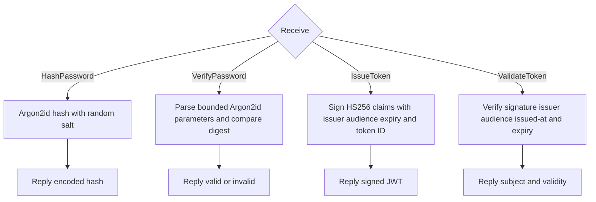

### AuthorizationActor

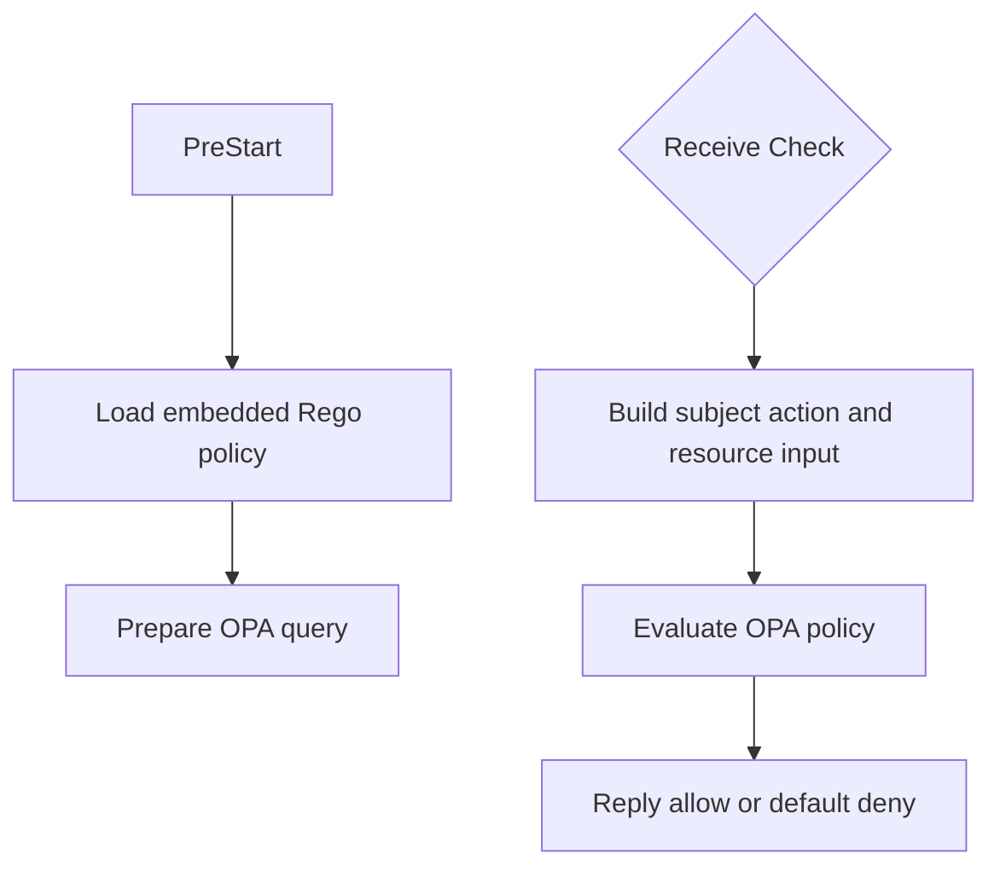

### PersistenceActor

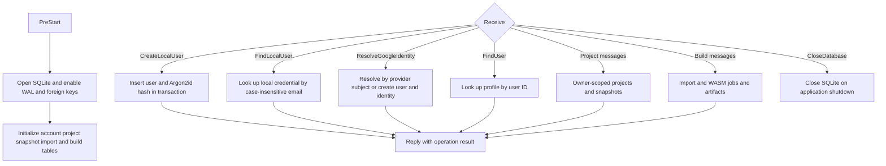

### AccountingActor

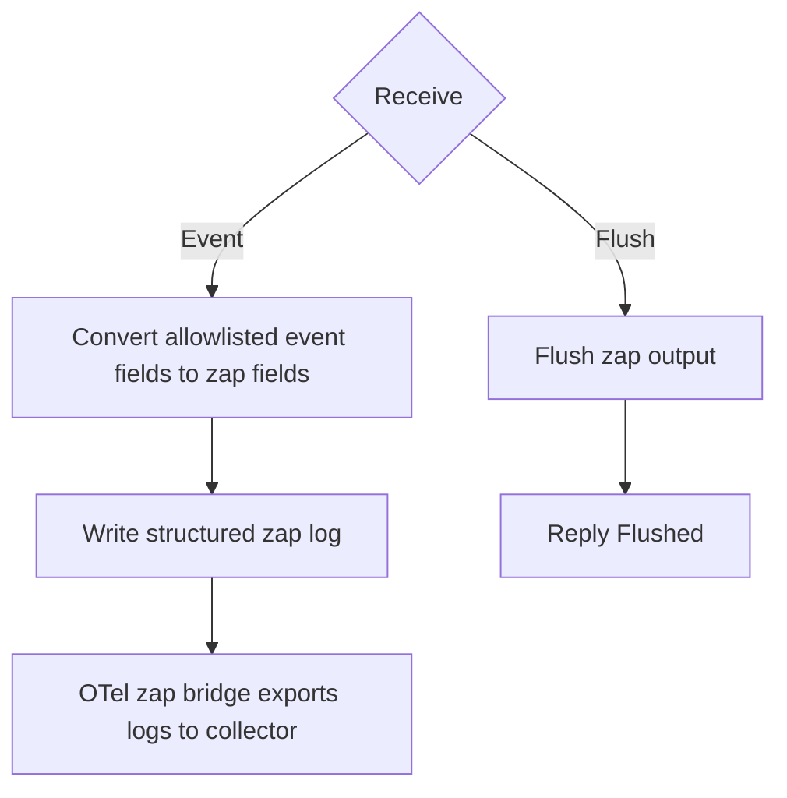

### TelemetryActor

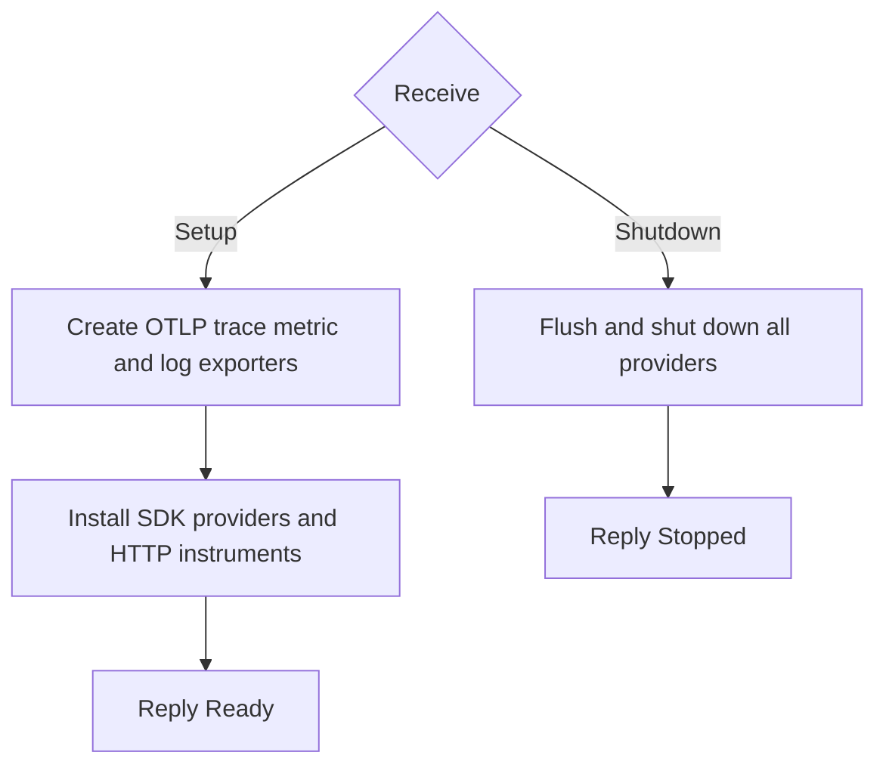

## Observability data flow

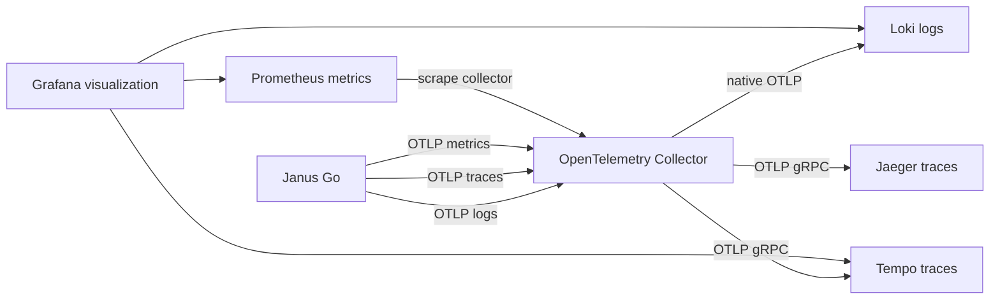
